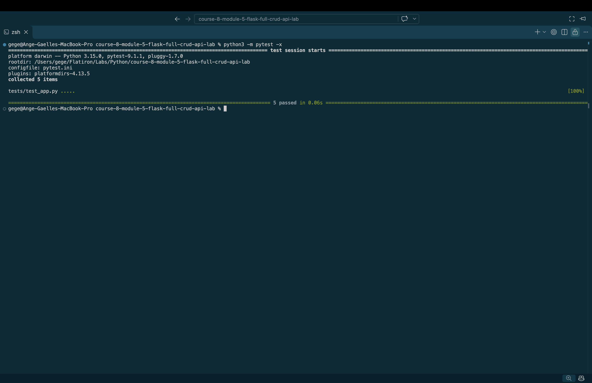

# Flask Events CRUD REST API

## Description

This project is a RESTful API built using Python and Flask. It allows users to create, retrieve, update, and delete events through HTTP requests.

The project demonstrates the four basic CRUD operations:

- **Create** — Add a new event.
- **Read** — Retrieve existing events.
- **Update** — Modify an event's title.
- **Delete** — Remove an event.

## Technologies Used

- Python 3
- Flask
- JSON
- Pytest

## Event Model

Each event contains two attributes:

- `id`: A unique identifier for the event.
- `title`: The name of the event.

Example:

```json
{
  "id": 1,
  "title": "Tech Meetup"
}
```

The `Event` class includes a `to_dict()` method that converts an event object into a Python dictionary so Flask can return it as JSON.

## Getting Started

### 1. Clone the Repository

```bash
git clone git@github.com:a-gbatie/course-8-module-5-flask-full-crud-api-lab.git
cd course-8-module-5-flask-full-crud-api-lab
```

### 2. Install Dependencies

Flask and pytest are required to run the application and its tests.

```bash
python3 -m pip install flask
```
```bash
python3 -m pip install pytest
```

### 3. Run the Flask Application

Start the server:

```bash
python3 app.py
```

By default, the application runs at:

http://127.0.0.1:5000

### 4. Run Tests

Run the automated tests:

```bash
python3 -m pytest -x
```

The `-x` option stops testing after the first failure.

## API Endpoints

### GET /

Returns a welcome message.

**Example response:**

```json
{
  "message": "Welcome to the Events API!"
}
```

**Status code:** `200 OK`

### GET /events

Returns a list of all events.

**Example response:**

```json
[
  {
    "id": 1,
    "title": "Tech Meetup"
  },
  {
    "id": 2,
    "title": "Python Workshop"
  }
]
```

**Status code:** `200 OK`

### POST /events

Creates a new event.

**Example request:**

```bash
curl -i -X POST http://127.0.0.1:5000/events \
  -H "Content-Type: application/json" \
  -d '{"title": "Hackathon"}'
```

**Example response:**

```json
{
  "id": 3,
  "title": "Hackathon"
}
```

**Status code:** `201 Created`

If a valid title is not provided, the API returns `400 Bad Request`.

### PATCH /events/<event_id>

Updates the title of an existing event.

**Example request:**

```bash
curl -i -X PATCH http://127.0.0.1:5000/events/1 \
  -H "Content-Type: application/json" \
  -d '{"title": "Tech Conference"}'
```

**Example response:**

```json
{
  "id": 1,
  "title": "Tech Conference"
}
```

**Status code:** `204 OK`

If the event does not exist, the API returns `404 Not Found`.

### DELETE /events/<event_id>

Deletes an existing event.

**Example request:**

```bash
curl -i -X DELETE http://127.0.0.1:5000/events/2
```

**Example response:**

```json
{
  "message": "Event deleted successfully"
}
```

**Status code:** `200 OK`

If the event does not exist, the API returns `404 Not Found`.

## HTTP Status Codes

The API uses the following HTTP status codes:

| Status Code | Meaning |
|-------------|---------|
| 200 | Request completed successfully |
| 201 | Resource created successfully |
| 400 | Invalid request data |
| 404 | Requested resource not found |

## Important Concepts

### RESTful APIs

REST is an architectural approach to designing web services. RESTful APIs use HTTP methods to perform operations on resources.

### Flask Routing

Flask uses the `@app.route()` decorator to connect URL endpoints with Python functions.

### JSON

JSON is used to exchange data between the client and server.

Flask's `jsonify()` function converts Python data structures into JSON responses.

### Request Handling

The `request.get_json()` method reads JSON data submitted by a client.

## Screenshot of Completed Tests
